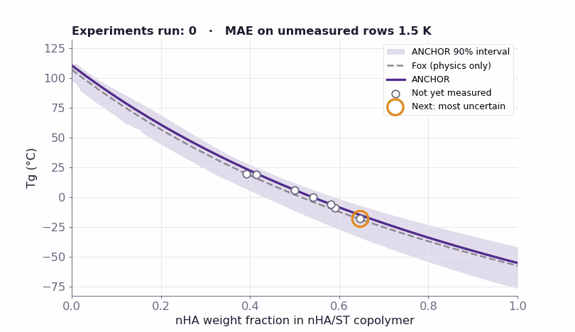
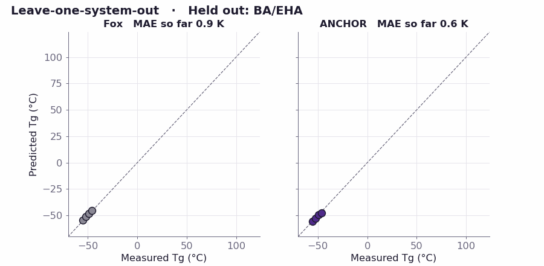
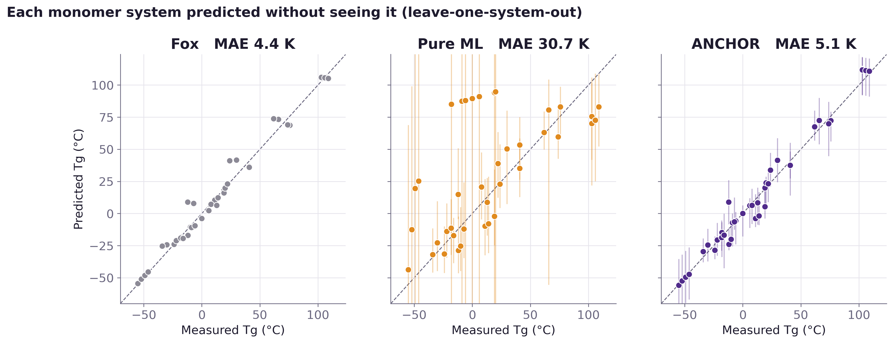
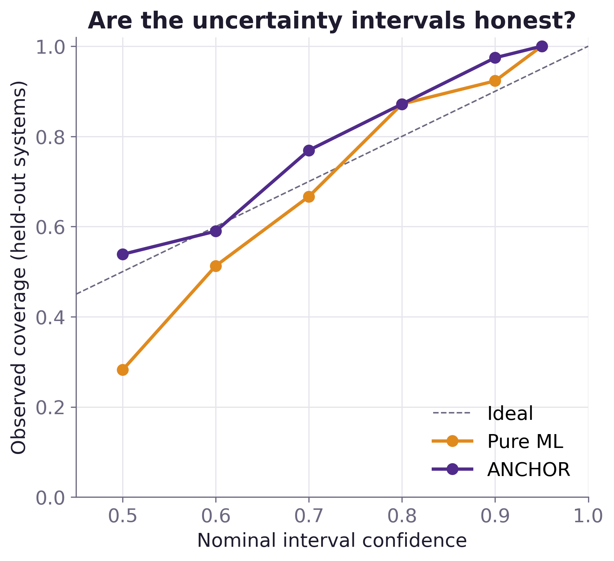
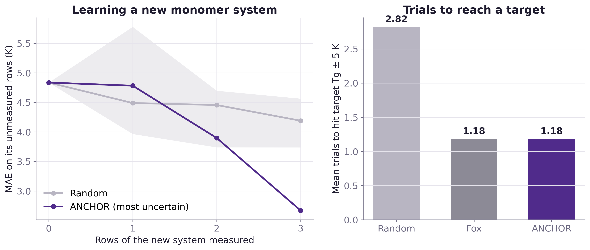
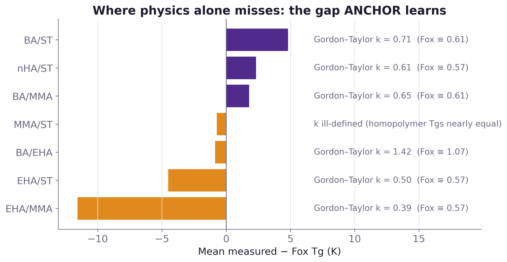
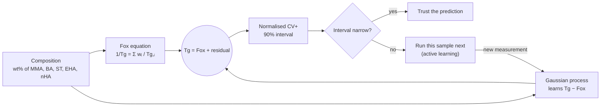

<p align="center">
  
</p>

<p align="center">
  
  
  
  
  
</p>

<h3 align="center">Physics says where Tg should be. Machine learning learns the gap. Conformal intervals say when to trust it.</h3>

---

## ⚓ Why ANCHOR

Every new latex binder starts with one number: the copolymer's **glass transition temperature (Tg)**. It sets the minimum film-forming temperature, block resistance and dirt pickup. Today chemists guess it with the 70-year-old **Fox equation**, then make and test samples until they hit it.

Pure machine learning should do better, but on a new monomer system it extrapolates silently, and on our data it was **seven times worse than Fox**. ANCHOR keeps physics in charge and lets a Gaussian process learn only what physics misses. Every prediction comes with a **90% interval that is honest about what the model has not seen**.

<p align="center">
  
  <br><sub><b>Active learning on a system ANCHOR has never seen.</b> It starts from Fox plus what it learned on six other systems, asks for the most uncertain composition, and its 90% band tightens with each measured sample.</sub>
</p>

## 📊 Results at a glance

Each of the 7 monomer systems is predicted with **that whole system held out** (leave-one-system-out), so every number below is extrapolation to new chemistry.

| Model | Held-out MAE | R² | 90% interval coverage | Mean interval width |
| :-- | --: | --: | --: | --: |
| Fox equation (physics only) | **4.4 K** | 0.98 | — | — |
| Pure ML (same GP, no physics) | 30.7 K | 0.04 | 92% | 131.8 K |
| **ANCHOR** (Fox + GP residual) | **5.1 K** | **0.97** | **97%** | **28.3 K** |

- 🧲 **Physics anchoring makes ML usable.** It cuts held-out error from 30.7 K to 5.1 K, and the interval shrinks from 132 K to 28 K.
- 🎯 **Fewer trials.** To hit a target Tg within ±5 K, ANCHOR needs **1.18 trials** on average against **2.82** for random picking, and hits on the **first try 87%** of the time.
- 📏 **Honest uncertainty.** At every confidence level from 50% to 95%, ANCHOR's observed coverage stays within a few points of, or above, the nominal level (for example 97% at 90%, 59% at 60%).
- ⚖️ **Where it falls short.** Fox alone is still slightly better on average (4.4 K vs 5.1 K). ANCHOR beats Fox on **5 of 7 systems** but loses on EHA/ST, where two sources disagree by about 18 K at nearly the same composition, and on MMA/ST. With 39 points, Fox is a strong baseline. ANCHOR's value today is calibrated uncertainty and a path to learn from new data, not a lower average error.

<p align="center">
  
</p>

<details>
<summary><b>📈 All figures</b></summary>

| | |
| :--: | :--: |
|  |  |
| **Parity:** held-out predictions with 90% intervals | **Calibration:** observed vs nominal coverage |
|  |  |
| **Active learning:** error vs samples, and trials to target | **Where physics misses:** mean measured − Fox per system |

</details>

## 🧪 How it works



1. **Physics prior.** The Fox equation, using homopolymer Tg values from the same curated experimental dataset as most of the copolymer data.
2. **Learned residual.** A Gaussian process with an ARD kernel (one length scale per feature) learns `Tg_measured − Tg_Fox` from composition. Where data is thin, it falls back to zero, so ANCHOR falls back to physics.
3. **Calibrated uncertainty.** Normalised CV+ conformal prediction ([Barber et al. 2021](https://doi.org/10.1214/20-AOS1965)) gives distribution-free 90% intervals that widen where the GP is unsure.
4. **Active learning.** The next experiment is the composition with the widest interval, or the one most likely to hit a target Tg.

Everything, including the figures, is under 900 lines of readable Python in [`src/anchor/`](src/anchor/), with no deep learning and no black box.

## 🗂️ The data

**39 measured copolymers** (all Tg by DSC; none calculated) across **7 monomer systems** from **3 sources**, curated by Mahi in [`data/ANCHOR_Final_51_With_Training_Status.xlsx`](data/ANCHOR_Final_51_With_Training_Status.xlsx).

| Source | Rows | Systems | Re-checked |
| :-- | :-: | :-- | :-- |
| Penzel et al., *Polymer* 38, 325 (1997), via [Bhati et al. 2026, Zenodo 19242815](https://zenodo.org/records/19242815) | 24 | BA/EHA, BA/MMA, BA/ST, EHA/MMA, EHA/ST, MMA/ST | ✅ every value against the Zenodo CSV |
| [Wang et al., *Macromol. Rapid Commun.* 45, 2400198 (2024)](https://doi.org/10.1002/marc.202400198), Table 1 | 13 | EHA/ST, nHA/ST | ✅ Tg and the mol% → wt% conversion |
| *Polym. Chem.* 2, 1769 (2011), [doi:10.1039/c1py00066g](https://doi.org/10.1039/c1py00066g) | 2 | BA/MMA | ⚠️ paywalled, not re-checked |
| [Taheri et al., *Des. Monomers Polym.* 22, 213 (2019)](https://doi.org/10.1080/15685551.2019.1699349), Table 4 | 12 *(excluded)* | MMA/BA/ST + ~1 wt% AA | ✅ values match; excluded because acrylic acid was not measured |

Homopolymer Tg values for the Fox prior are in [`data/homopolymer_tg.csv`](data/homopolymer_tg.csv), each traced to a row of the same Zenodo dataset. Run `python scripts/verify_sources.py` to re-download the open sources and re-check every value.

> **Stress test, and the honest caveat.** Trained on all 39 rows, ANCHOR predicts the 12 excluded Taheri resins with 5.4 K error (Fox: 7.2 K), but its 90% intervals cover only 8% of them. Those resins differ in things the model cannot see: low molecular weight and unmeasured acrylic acid. Uncertainty can only cover what the inputs describe, which is why molecular weight (Flory–Fox) is the next feature on the roadmap.

## 🚀 Quickstart

```bash
git clone https://github.com/Mxhi-04/ANCHOR.git && cd ANCHOR
python3 -m venv .venv && .venv/bin/pip install -r requirements.txt
PYTHONPATH=src .venv/bin/pytest -q                # 12 tests
PYTHONPATH=src .venv/bin/python -m anchor.run     # ~6 min: every number, figure and GIF
```

Outputs land in [`outputs/`](outputs/): `metrics.json`, `metrics.md`, `predictions.csv`, the figures, and [`results.xlsx`](outputs/results.xlsx), a workbook with the data, sources, held-out predictions, metrics and the active-learning replay.

## 🧭 Repository map

```text
ANCHOR/
├── data/                  measured Tg workbook (Mahi) + homopolymer Tg table
├── src/anchor/
│   ├── data.py            load + validate data, canonical system labels
│   ├── physics.py         Fox and Gordon–Taylor
│   ├── models.py          ANCHOR, pure-ML baseline, normalised CV+ intervals
│   ├── validate.py        leave-one-system-out validation, stress test
│   ├── active.py          active-learning replay (learning curves, trials to target)
│   ├── report.py          figures, GIFs, results.xlsx
│   └── run.py             one command rebuilds everything
├── scripts/verify_sources.py   re-checks the data against open sources
├── tests/                 12 tests (physics identities, leakage, interval maths)
├── outputs/               metrics, predictions, figures, results.xlsx
└── assets/                banner + README GIFs
```

## 🛣️ Roadmap

- [x] Proof of concept: copolymer Tg on 39 literature measurements, held-out by system
- [ ] Add molecular weight (Flory–Fox) and functional monomers (AA, MAA, HEMA) as inputs
- [ ] Scale to 150–300 measurements; pilot on in-house DSC/DMA data
- [ ] Extend from Tg to MFFT, film formation and durability

## 👥 Team Rize · Manipal University Jaipur

| | Role |
| :-- | :-- |
| **Jatin Pandey** | Model, code, validation, active learning |
| **Mahi Patni** | Data curation and audit, chemistry, deck |

Built for **Asian Paints Alchemy 2026, Case Study 4**: structure–property relationships of polymers and coatings via modelling, simulation and AI.

## 🤖 AI use

The Alchemy rules ask for AI use to be labelled. Claude Code wrote the code and figures under our review, and Google Antigravity helped search and extract literature tables, with every value checked against its source. The concept, the method choices and the conclusions are ours. Details are in [`AI_USE.md`](AI_USE.md).

## 📚 References

1. T. G. Fox, *Bull. Am. Phys. Soc.* 1, 123 (1956).
2. M. Gordon, J. S. Taylor, *J. Appl. Chem.* 2, 493 (1952).
3. R. F. Barber, E. J. Candès, A. Ramdas, R. J. Tibshirani, "Predictive inference with the jackknife+," *Ann. Statist.* 49, 486 (2021).
4. C. E. Rasmussen, C. K. I. Williams, *Gaussian Processes for Machine Learning*, MIT Press (2006).
5. Data sources as listed in [The data](#️-the-data).

<p align="center"><sub>MIT License · © 2026 Team Rize</sub></p>
